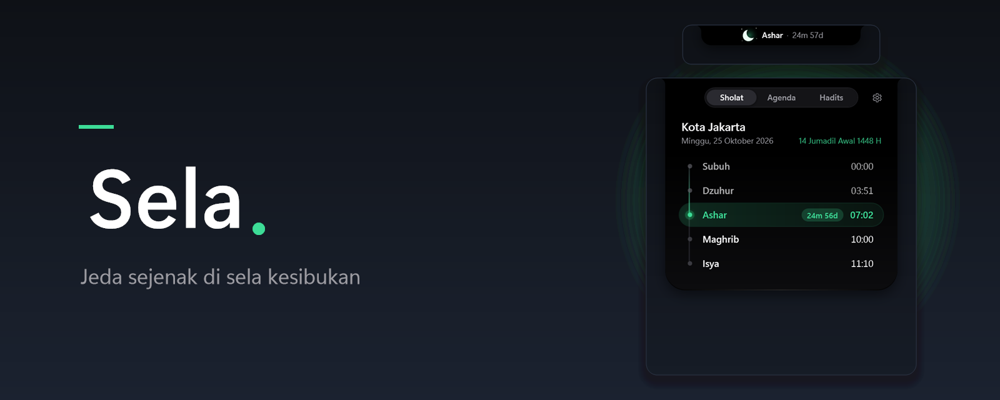
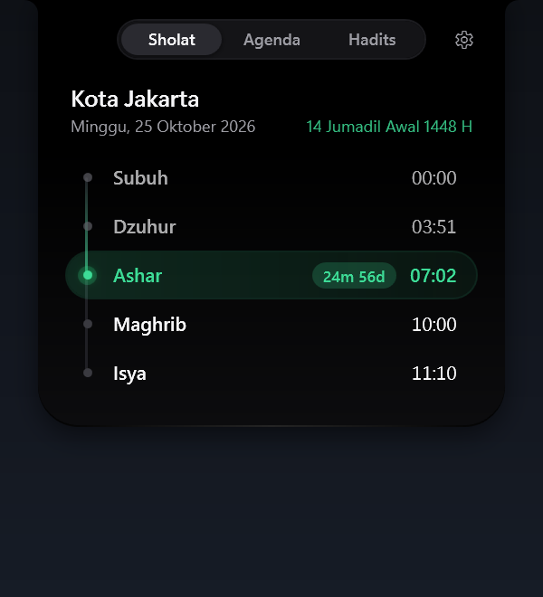
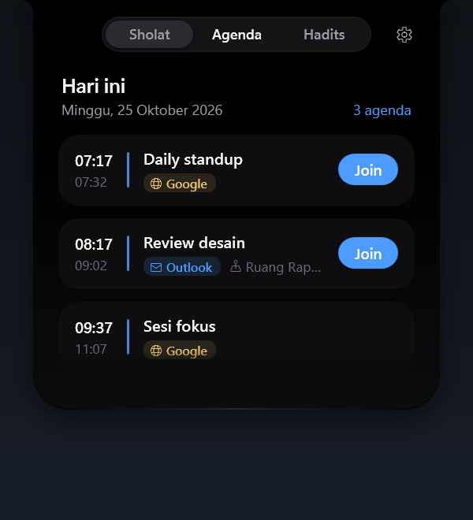
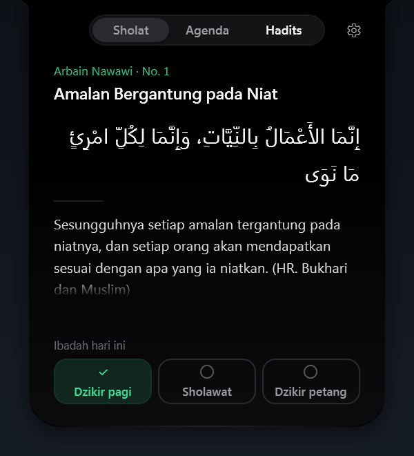
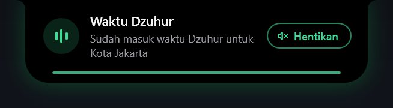
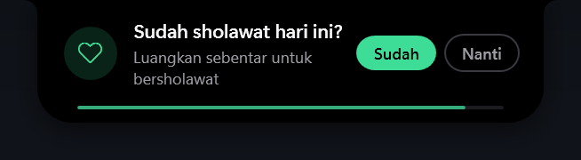
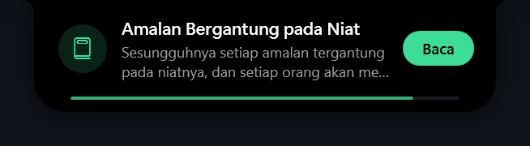
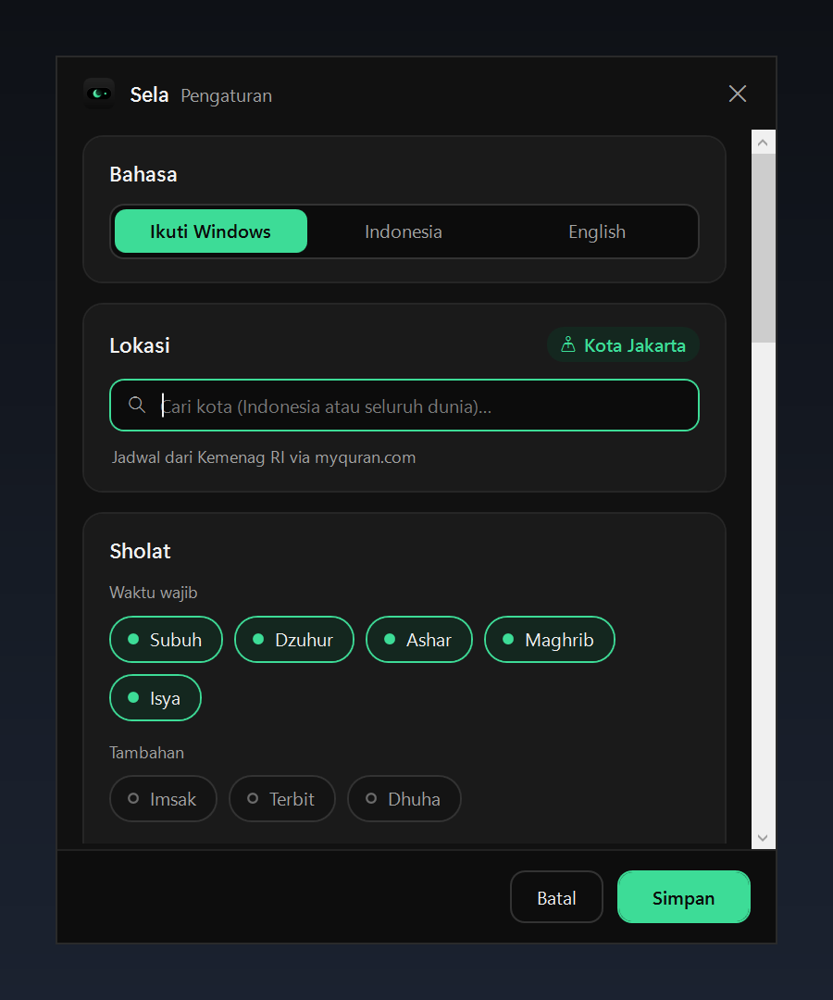

<p align="center">
  <a href="README.md">English</a> · <b>Bahasa Indonesia</b>
</p>

<p align="center">
  
</p>

<h1 align="center">Sela</h1>

<p align="center">
  Jeda sejenak di sela kesibukan.<br>
  Notch kecil di atas layar Windows untuk jadwal sholat, adzan, pengingat ibadah harian, dan meeting.
</p>

<p align="center">
  <a href="https://github.com/agusumri/sela/releases/latest"></a>
  <a href="LICENSE"></a>
  
  
</p>

Sela duduk di atas layar sebagai pill hitam kecil. Pill itu menampilkan sholat berikutnya dan countdown yang terus berjalan, ditemani maskot bulan sabit yang ikut berubah sesuai waktu. Arahkan kursor untuk melihat ringkasan, klik untuk membuka jadwal lengkap, agenda hari ini, dan hadits harian.

## Fitur

- **Jadwal sholat di mana saja**: kota di Indonesia memakai jadwal resmi Kemenag RI (lewat [api.myquran.com](https://api.myquran.com)). Kota lain memakai [Aladhan](https://aladhan.com) dengan metode perhitungan pilihan kamu, misalnya Muslim World League, ISNA, atau Umm al-Qura, dan bisa memakai Ashar mazhab Hanafi.
- **Pengingat sholat** beberapa menit sebelum waktunya dan saat masuk waktu, dengan countdown jam, menit, dan detik.
- **Adzan** saat masuk waktu, dengan pilihan per waktu, volume, mode bisu, dan file adzan sendiri (termasuk khusus Subuh).
- **Pengingat dzikir dan sholawat**: Sela bertanya sekali setelah Subuh, Dzuhur, dan Ashar. Jawab **Sudah** atau **Nanti**.
- **Hadits harian** dari Arbain Nawawi, dalam teks Arab beserta terjemahan Indonesia atau Inggris.
- **Agenda meeting** dari Outlook (aplikasi klasik) dan Google Calendar, lengkap dengan tanda sumbernya dan tombol **Join** untuk Teams, Zoom, Google Meet, dan Webex.
- **Bahasa Indonesia dan Inggris**: mengikuti bahasa Windows secara default, dan bisa diganti kapan saja di Pengaturan.
- **Bisa dipindah**: geser notch ke kiri, kanan, atau ke tepi bawah layar. Sela mengingat posisinya.
- **Maskot yang hidup**: fajar, siang, sore, dan malam punya tampilan sendiri, bergerak pelan, dan melirik ke arah kursor.
- **Tetap jalan saat offline**: jadwal dan hadits disimpan di perangkat.
- **Tidak mengganggu**: notch disembunyikan saat aplikasi layar penuh berjalan, tidak mengambil fokus, dan tidak muncul di taskbar.

## Tampilan

Screenshot memakai data contoh untuk Jakarta.

| Notch sepanjang hari |
| --- |
|     |

| Jadwal sholat | Agenda hari ini | Hadits harian |
| --- | --- | --- |
|  |  |  |

| Masuk waktu sholat | Pengingat dzikir | Hadits hari ini |
| --- | --- | --- |
|  |  |  |

<p align="center">
  
</p>

## Unduh dan pasang

Sela berjalan di Windows 10 atau 11 (64-bit). Kamu tidak perlu memasang .NET.

1. Buka halaman [Rilis terbaru](https://github.com/agusumri/sela/releases/latest).
2. Unduh salah satu file berikut:
   - `Sela-Setup-VERSI.exe`: installer. Sela dipasang untuk akun kamu saja, tanpa hak admin, dan muncul di Start Menu.
   - `Sela-VERSI-portable.exe`: satu file yang langsung dijalankan tanpa dipasang.
3. Jalankan file tersebut. Ikon Sela muncul di tray dan notch muncul di atas layar.

> [!NOTE]
> File rilis belum ditandatangani secara digital, jadi Windows SmartScreen mungkin menampilkan peringatan. Klik **Info lainnya**, lalu **Tetap jalankan**. Kamu bisa mencocokkan file dengan `SHA256SUMS.txt` di halaman rilis.

## Mulai pakai

1. Klik kanan ikon Sela di tray, lalu klik **Pengaturan**.
2. Di **Bahasa**, biarkan **Ikuti Windows** atau pilih **Indonesia** atau **English**.
3. Di **Lokasi**, ketik nama kota kamu, lalu pilih dari daftar. Kota di Indonesia maupun di luar negeri bisa dicari.
4. Opsional: untuk kota di luar Indonesia, pilih **Metode perhitungan** yang sesuai dengan masjid setempat, dan nyalakan **Ashar mazhab Hanafi** kalau kamu mengikutinya.
5. Di **Meeting**, atur sumber agenda:
   - **Outlook**: nyalakan **Outlook (aplikasi klasik)**. Sela membaca kalender dari Outlook yang sedang terbuka, tanpa mengubah apa pun.
   - **Google Calendar**: buka Google Calendar di web, lalu buka **Setelan** > pilih kalender > **Integrasikan kalender**. Salin **Alamat rahasia dalam format iCal**, lalu tempel ke kolom Google Calendar di Sela.
6. Klik **Simpan**.

Setelah itu notch langsung menampilkan sholat berikutnya. Untuk memastikan pengingat dan adzan bekerja, klik kanan ikon tray lalu klik **Tes notifikasi**.

### Cara memakai notch

- **Arahkan kursor** ke pill untuk melihat sholat berikutnya dan meeting terdekat.
- **Klik** pill untuk membuka tab **Sholat**, **Agenda**, dan **Hadits**. Tekan `Esc` atau pindahkan kursor untuk menutupnya.
- **Geser** pill untuk memindahkannya ke kiri, kanan, atau ke tepi bawah layar. Untuk mengembalikannya, klik kanan ikon tray lalu klik **Kembalikan posisi notch**.
- Saat adzan berbunyi, klik **Hentikan** di kartu pengingat, atau klik **Hentikan adzan** di menu tray. Untuk membisukan adzan sementara, centang **Bisukan adzan** di menu tray.

## Privasi

Sela tidak punya server dan tidak mengirim data pribadi ke mana pun. Sela hanya menghubungi:

- `api.myquran.com` untuk jadwal sholat dan hadits berbahasa Indonesia,
- `api.aladhan.com` untuk jadwal sholat di luar Indonesia, memakai koordinat kota yang kamu pilih,
- `geocoding-api.open-meteo.com` untuk pencarian kota,
- `cdn.jsdelivr.net` untuk hadits berbahasa Inggris,
- alamat iCal Google yang kamu masukkan.

Hal lainnya:

- Kalender Outlook dibaca langsung dari aplikasi Outlook di perangkat kamu.
- Alamat iCal Google disimpan terenkripsi dengan Windows DPAPI, jadi hanya bisa dibuka oleh akun Windows kamu.
- Pengaturan, cache, dan log disimpan di `%LOCALAPPDATA%\Sela`. Hapus folder itu untuk menghapus semua data Sela.

## Untuk pengembang

Sela ditulis dengan C# dan WPF di .NET 10.

| Folder | Isi |
| --- | --- |
| `src/Sela.Core` | Logika tanpa UI: klien jadwal sholat dan hadits beserta cache, pencarian lokasi, pembaca iCal, penjadwal pengingat, penyimpanan pengaturan |
| `src/Sela` | Aplikasi WPF: notch, maskot, jendela pengaturan, tray, pembaca Outlook, pemutar adzan, terjemahan (`Localization/`) |
| `tests/Sela.Core.Tests` | Tes xUnit untuk `Sela.Core` |
| `installer` | Skrip Inno Setup untuk installer |
| `tools` | Skrip build rilis, screenshot, dan pembuat ikon |

### Build dari source

Sebelum mulai, pasang [.NET 10 SDK](https://dotnet.microsoft.com/download/dotnet/10.0).

Untuk build, menjalankan tes, dan membuka aplikasi, jalankan perintah berikut:

```powershell
dotnet build
dotnet test tests/Sela.Core.Tests
dotnet run --project src/Sela
```

Untuk membuat file rilis (exe portable, installer, dan `SHA256SUMS.txt`) di folder `dist`, pasang [Inno Setup 6](https://jrsoftware.org/isinfo.php), lalu jalankan:

```powershell
./tools/build-release.ps1
```

### Menambah atau mengubah terjemahan

Semua teks antarmuka ada di `src/Sela/Localization`, satu file per bagian: `Loc.Notch.cs`, `Loc.Settings.cs`, dan `Loc.Shell.cs`. Setiap entri berisi teks Indonesia dan Inggris untuk satu kunci:

```csharp
["Notch_NextPrayer"] = ("Sholat berikutnya", "Next prayer"),
```

Nama sholat dan ibadah harian ada di `src/Sela.Core/Localization.cs`. Kunci yang belum ada ditampilkan apa adanya di layar dan dicatat sekali di `%LOCALAPPDATA%\Sela\log.txt`.

### Opsi baris perintah

Opsi berikut membantu saat mencoba tampilan atau membuat screenshot:

| Opsi | Fungsi |
| --- | --- |
| `--lang=en`, `--lang=id` | Memakai bahasa Inggris atau Indonesia untuk sesi ini saja |
| `--mock` | Memakai data contoh tanpa membaca kalender, pengaturan, atau registri |
| `--demo` | Menampilkan contoh pengingat sholat dan meeting satu per satu |
| `--test-notify` | Menampilkan satu contoh pengingat masuk waktu sholat |
| `--test-adhan` | Memutar adzan Dzuhur |
| `--test-habit`, `--test-hadith` | Menampilkan contoh kartu pengingat ibadah atau kartu hadits harian |
| `--settings` | Membuka pengaturan saat aplikasi mulai |
| `--panel`, `--panel=agenda`, `--panel=hadits` | Membuka panel di tab Sholat, Agenda, atau Hadits saat aplikasi mulai |
| `--sky=dawn`, `--sky=day`, `--sky=dusk`, `--sky=night` | Memaksa tampilan maskot untuk satu waktu |
| `--excited` | Menampilkan maskot dalam mode menjelang sholat |
| `--sky-tour` | Berganti ke semua tampilan maskot setiap 6 detik |

### Rilis

Untuk membuat rilis, push tag versi. GitHub Actions menjalankan tes, membuat exe portable dan installer, lalu melampirkannya ke GitHub Release:

```powershell
git tag v1.1.0
git push origin v1.1.0
```

## Kredit

- Jadwal sholat dan hadits Indonesia: Kemenag RI melalui [api.myquran.com](https://api.myquran.com).
- Jadwal sholat di luar Indonesia: [Aladhan](https://aladhan.com).
- Pencarian kota: [Open-Meteo Geocoding API](https://open-meteo.com/en/docs/geocoding-api).
- Teks hadits Inggris dan Arab: [fawazahmed0/hadith-api](https://github.com/fawazahmed0/hadith-api) (Unlicense).
- Suara adzan bawaan: [Adhan.ogg](https://commons.wikimedia.org/wiki/File:Adhan.ogg) oleh Aishatu98, CC0 1.0. Lihat [`CREDITS.txt`](src/Sela/Assets/Audio/CREDITS.txt).

## Lisensi

Sela dirilis dengan [lisensi MIT](LICENSE). Kamu bebas memakai, mengubah, dan membagikannya.
