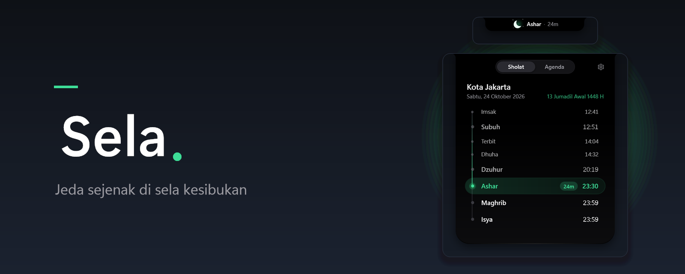
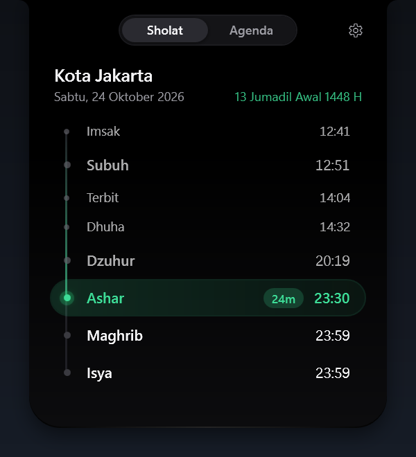
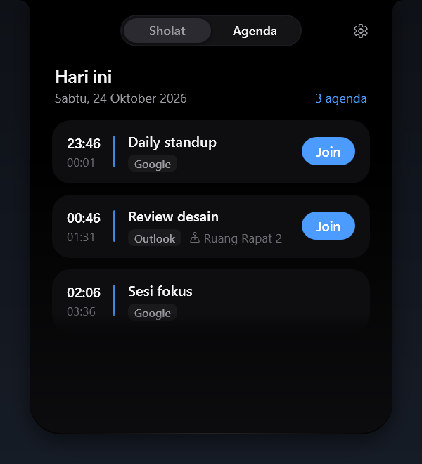
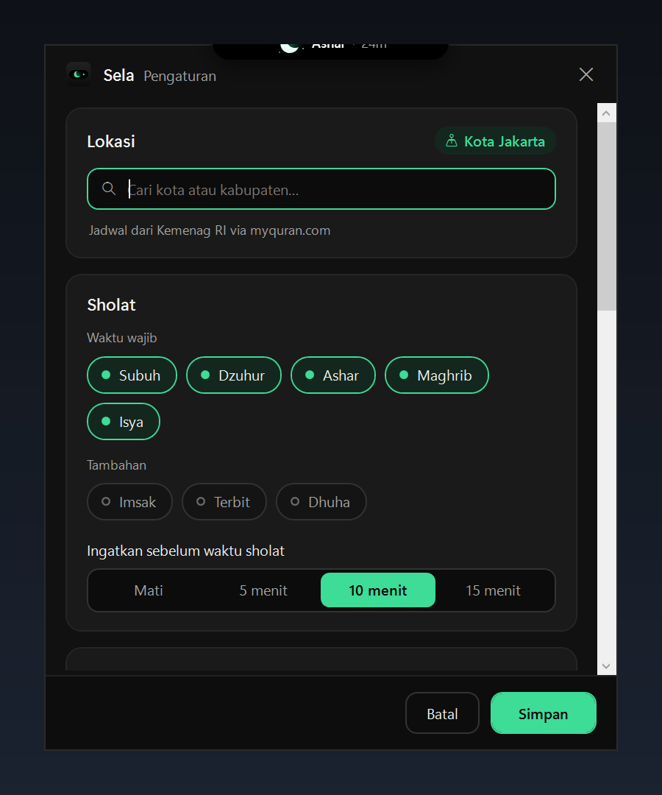

<p align="center">
  
</p>

<h1 align="center">Sela</h1>

<p align="center">
  Jeda sejenak di sela kesibukan.<br>
  Notch kecil di atas layar Windows untuk jadwal sholat, adzan, dan pengingat meeting.
</p>

<p align="center">
  <a href="https://github.com/agusumri/sela/releases/latest"></a>
  <a href="LICENSE"></a>
  
  
</p>

Sela duduk di tengah atas layar sebagai pill hitam kecil. Pill itu menampilkan sholat berikutnya dan sisa waktunya, ditemani maskot bulan sabit yang ikut berubah sesuai waktu. Arahkan kursor untuk melihat ringkasan, klik untuk membuka jadwal lengkap dan agenda hari ini.

## Fitur

- **Jadwal sholat lengkap** dari data Kemenag RI (lewat [api.myquran.com](https://api.myquran.com)): Imsak, Subuh, Terbit, Dhuha, Dzuhur, Ashar, Maghrib, dan Isya, untuk 500+ kota dan kabupaten di Indonesia.
- **Pengingat sholat** beberapa menit sebelum waktunya dan saat masuk waktu.
- **Adzan** saat masuk waktu, dengan pilihan per waktu, volume, mode bisu, dan file adzan sendiri (termasuk khusus Subuh).
- **Agenda meeting** dari Outlook (aplikasi klasik) dan Google Calendar, dengan tombol **Join** untuk Teams, Zoom, Google Meet, dan Webex.
- **Maskot yang hidup**: fajar, siang, sore, dan malam punya tampilan sendiri, bergerak pelan, dan melirik ke arah kursor.
- **Tetap jalan saat offline**: jadwal disimpan per bulan di perangkat.
- **Sopan terhadap layar**: notch disembunyikan saat aplikasi layar penuh berjalan, tidak mengambil fokus, dan tidak muncul di taskbar.

## Tampilan

| Diam (malam) | Diam (siang) |
| --- | --- |
|  |  |

| Jadwal sholat | Agenda hari ini |
| --- | --- |
|  |  |

| Masuk waktu sholat | Pengaturan |
| --- | --- |
|  |  |

## Unduh dan pasang

Sela berjalan di Windows 10 atau 11 (64-bit). Kamu tidak perlu memasang .NET.

1. Buka halaman [Rilis terbaru](https://github.com/agusumri/sela/releases/latest).
2. Unduh salah satu file berikut:
   - `Sela-Setup-VERSI.exe`: installer. Sela dipasang untuk akun kamu saja, tanpa hak admin, dan muncul di Start Menu.
   - `Sela-VERSI-portable.exe`: satu file yang langsung dijalankan tanpa dipasang.
3. Jalankan file tersebut. Ikon Sela muncul di tray dan notch muncul di tengah atas layar.

> [!NOTE]
> File rilis belum ditandatangani secara digital, jadi Windows SmartScreen mungkin menampilkan peringatan. Klik **Info lainnya**, lalu **Tetap jalankan**. Kamu bisa mencocokkan file dengan `SHA256SUMS.txt` di halaman rilis.

## Mulai pakai

1. Klik kanan ikon Sela di tray, lalu klik **Pengaturan**.
2. Di **Lokasi**, ketik nama kota atau kabupaten kamu, lalu pilih dari daftar.
3. Di **Meeting**, atur sumber agenda:
   - **Outlook**: nyalakan **Outlook (aplikasi klasik)**. Sela membaca kalender dari Outlook yang sedang terbuka, tanpa mengubah apa pun.
   - **Google Calendar**: buka Google Calendar di web, lalu buka **Setelan** > pilih kalender > **Integrasikan kalender**. Salin **Alamat rahasia dalam format iCal**, lalu tempel ke kolom Google Calendar di Sela.
4. Klik **Simpan**.

Setelah itu notch langsung menampilkan sholat berikutnya. Untuk memastikan pengingat dan adzan bekerja, klik kanan ikon tray lalu klik **Tes notifikasi**.

### Cara memakai notch

- **Arahkan kursor** ke pill untuk melihat sholat berikutnya dan meeting terdekat.
- **Klik** pill untuk membuka panel **Sholat** dan **Agenda**. Tekan `Esc` atau pindahkan kursor untuk menutupnya.
- Saat adzan berbunyi, klik **Hentikan** di kartu pengingat, atau klik **Hentikan adzan** di menu tray.
- Untuk membisukan adzan sementara, centang **Bisukan adzan** di menu tray.

## Privasi

Sela tidak punya server dan tidak mengirim data pribadi ke mana pun.

- Sela hanya menghubungi `api.myquran.com` untuk jadwal sholat dan alamat iCal Google yang kamu masukkan.
- Kalender Outlook dibaca langsung dari aplikasi Outlook di perangkat kamu.
- Alamat iCal Google disimpan terenkripsi dengan Windows DPAPI, jadi hanya bisa dibuka oleh akun Windows kamu.
- Pengaturan, cache jadwal, dan log disimpan di `%LOCALAPPDATA%\Sela`. Hapus folder itu untuk menghapus semua data Sela.

## Untuk pengembang

Sela ditulis dengan C# dan WPF di .NET 10.

| Folder | Isi |
| --- | --- |
| `src/Sela.Core` | Logika tanpa UI: klien API jadwal sholat dan cache, pembaca iCal, penjadwal pengingat, penyimpanan pengaturan |
| `src/Sela` | Aplikasi WPF: notch, maskot, jendela pengaturan, tray, pembaca Outlook, pemutar adzan |
| `tests/Sela.Core.Tests` | Tes xUnit untuk `Sela.Core` |
| `installer` | Skrip Inno Setup untuk installer |
| `tools` | Skrip build rilis dan pembuat ikon |

### Build dari source

Sebelum mulai, pasang [.NET 10 SDK](https://dotnet.microsoft.com/download/dotnet/10.0).

Untuk build, jalankan tes, dan membuka aplikasi, jalankan perintah berikut:

```powershell
dotnet build
dotnet test tests/Sela.Core.Tests
dotnet run --project src/Sela
```

Untuk membuat file rilis (exe portable, installer, dan `SHA256SUMS.txt`) di folder `dist`, pasang [Inno Setup 6](https://jrsoftware.org/isinfo.php), lalu jalankan:

```powershell
./tools/build-release.ps1
```

### Opsi baris perintah

Opsi berikut membantu saat mencoba tampilan atau membuat screenshot:

| Opsi | Fungsi |
| --- | --- |
| `--demo` | Menampilkan contoh pengingat sholat dan meeting satu per satu |
| `--test-notify` | Menampilkan satu contoh pengingat masuk waktu sholat |
| `--test-adhan` | Memutar adzan Dzuhur |
| `--settings` | Membuka pengaturan saat aplikasi mulai |
| `--panel`, `--panel=agenda` | Membuka panel jadwal atau agenda saat aplikasi mulai |
| `--sky=dawn`, `--sky=day`, `--sky=dusk`, `--sky=night` | Memaksa tampilan maskot untuk satu waktu |
| `--excited` | Menampilkan maskot dalam mode menjelang sholat |
| `--sky-tour` | Berganti ke semua tampilan maskot setiap 6 detik |
| `--mock` | Memakai data contoh tanpa membaca kalender, pengaturan, atau registri |

### Rilis

Push tag versi untuk membuat rilis. GitHub Actions menjalankan tes, membuat exe portable dan installer, lalu melampirkannya ke GitHub Release:

```powershell
git tag v1.0.1
git push origin v1.0.1
```

## Kredit

- Jadwal sholat: Kemenag RI melalui [api.myquran.com](https://api.myquran.com).
- Suara adzan bawaan: [Adhan.ogg](https://commons.wikimedia.org/wiki/File:Adhan.ogg) oleh Aishatu98, CC0 1.0. Lihat [`CREDITS.txt`](src/Sela/Assets/Audio/CREDITS.txt).

## Lisensi

Sela dirilis dengan [lisensi MIT](LICENSE). Kamu bebas memakai, mengubah, dan membagikannya.
