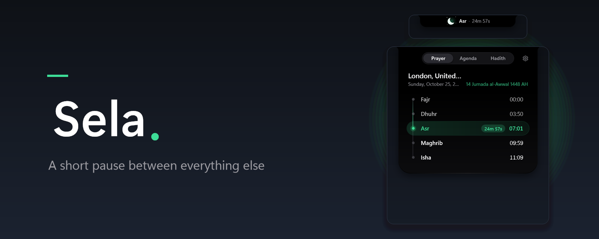
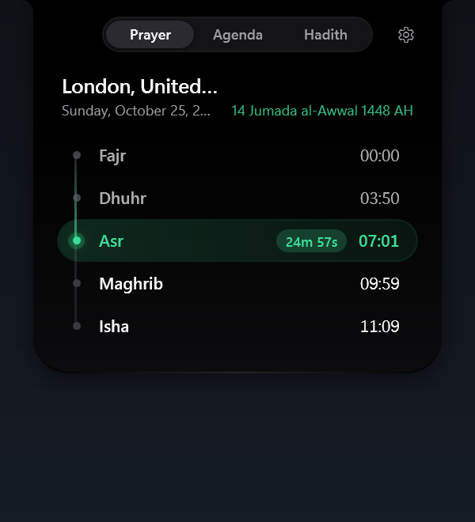
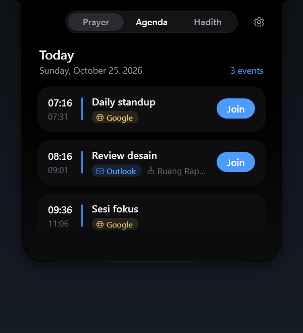
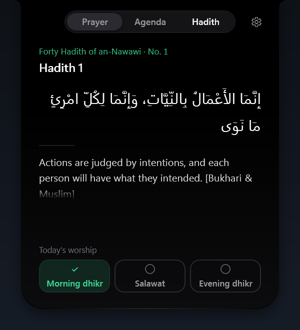
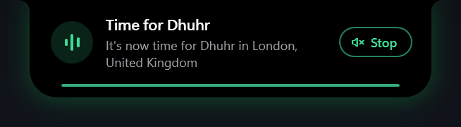
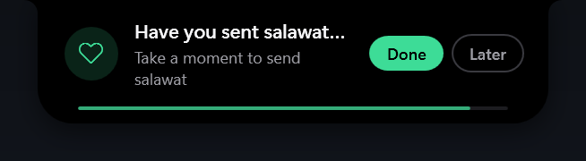
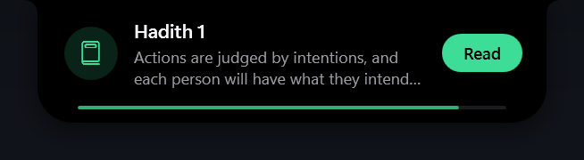
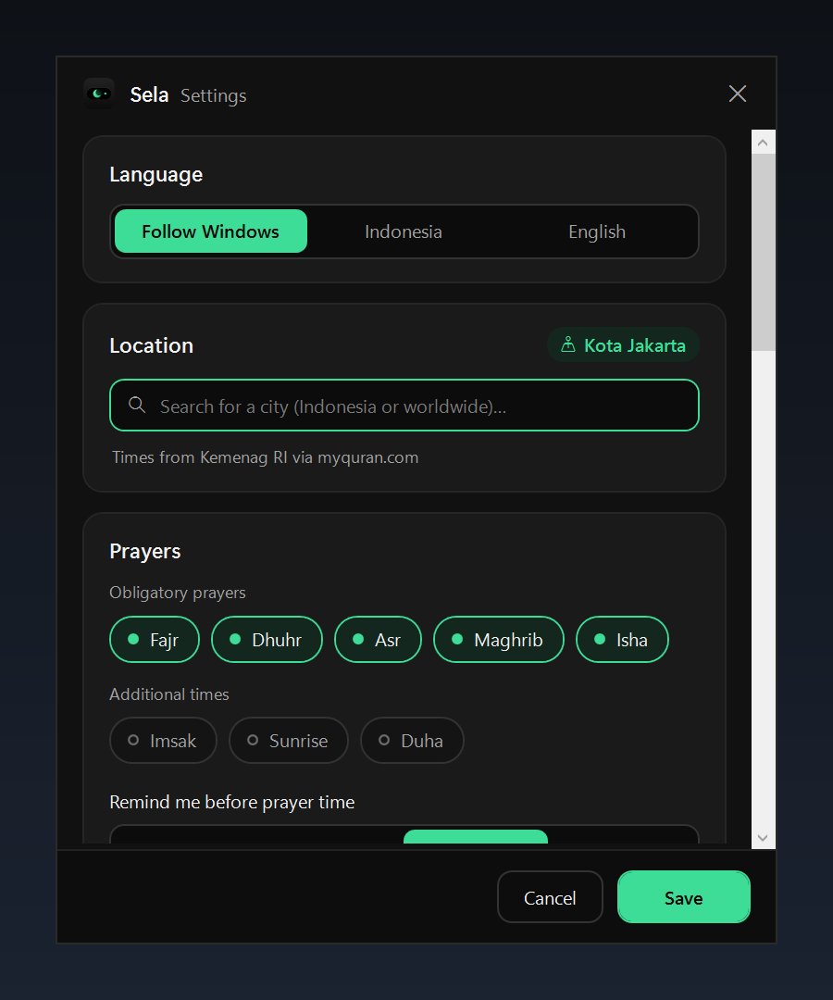

<p align="center">
  <b>English</b> · <a href="README.id.md">Bahasa Indonesia</a>
</p>

<p align="center">
  
</p>

<p align="center">
  
</p>

<h1 align="center">Sela</h1>

<p align="center">
  A short pause between everything else.<br>
  A small notch at the top of your Windows screen for prayer times, the adhan, daily reminders, and meetings.
</p>

<p align="center">
  <a href="https://github.com/agusumri/sela/releases/latest"></a>
  <a href="LICENSE"></a>
  
  
</p>

Sela sits at the top of your screen as a small black pill. It shows the next prayer and a live countdown, with a crescent mascot that changes with the time of day. Hover to see a summary; click to open the full schedule, today's agenda, and a daily hadith.

## Features

- **Prayer times anywhere**: Indonesian cities use official Kemenag RI times (through [api.myquran.com](https://api.myquran.com)); every other city uses [Aladhan](https://aladhan.com) with the calculation method of your choice, such as Muslim World League, ISNA, or Umm al-Qura, and an optional Hanafi Asr.
- **Prayer reminders** a few minutes before each prayer and when it begins, with a countdown in hours, minutes, and seconds.
- **Adhan** when a prayer begins, with per-prayer choices, volume, mute, and your own audio files (including a separate one for Fajr).
- **Dhikr and salawat check-ins**: Sela asks once after Fajr, Dhuhr, and Asr. Answer **Done** or **Later**.
- **Daily hadith** from the Forty Hadith of an-Nawawi, in Arabic with an English or Indonesian translation.
- **Meetings** from Outlook (classic desktop app) and Google Calendar, each marked with its source, with a **Join** button for Teams, Zoom, Google Meet, and Webex.
- **English and Indonesian**: follows your Windows language by default, and you can switch at any time in Settings.
- **Place it where you like**: drag the notch along the top or bottom edge of the screen. Sela remembers the spot.
- **A living mascot** with its own look for dawn, day, dusk, and night. It moves slowly and glances toward your cursor.
- **Works offline**: schedules and hadith are cached on your PC.
- **Stays out of the way**: hides during full-screen apps, never takes focus, and has no taskbar button.

## Screenshots

The screenshots use sample data for London.

| The notch through the day |
| --- |
|     |

| Prayer schedule | Today's agenda | Daily hadith |
| --- | --- | --- |
|  |  |  |

| Prayer time | Dhikr check-in | Hadith of the day |
| --- | --- | --- |
|  |  |  |

<p align="center">
  
</p>

## Download and install

Sela runs on Windows 10 or 11 (64-bit). You don't need to install .NET.

1. Open the [latest release](https://github.com/agusumri/sela/releases/latest).
2. Download one of these files:
   - `Sela-Setup-VERSION.exe`: the installer. It installs Sela for your account only, without admin rights, and adds it to the Start menu.
   - `Sela-VERSION-portable.exe`: a single file you run directly, without installing.
3. Run the file. The Sela icon appears in the notification area and the notch appears at the top of the screen.

> [!NOTE]
> Release files aren't digitally signed yet, so Windows SmartScreen might show a warning. Click **More info**, then **Run anyway**. You can check the files against `SHA256SUMS.txt` on the release page.

## Get started

1. Right-click the Sela icon in the notification area, then click **Settings**.
2. Under **Language**, keep **Follow Windows** or pick **English** or **Indonesia**.
3. Under **Location**, type your city and select it from the list.
4. Optional: for a city outside Indonesia, choose a **Calculation method** that matches your local mosque, and turn on **Asr: Hanafi method** if you follow it.
5. Under **Meetings**, set up your calendars:
   - **Outlook**: turn on **Outlook (classic app)**. Sela reads the calendar from the Outlook app that's open on your PC and never changes it.
   - **Google Calendar**: open Google Calendar on the web, then go to **Settings** > select your calendar > **Integrate calendar**. Copy the **Secret address in iCal format** and paste it into the Google Calendar field in Sela.
6. Click **Save**.

The notch shows the next prayer right away. To check that reminders and the adhan work, right-click the tray icon and click **Test notification**.

### Use the notch

- **Hover** over the pill to see the next prayer and your next meeting.
- **Click** the pill to open the **Prayer**, **Agenda**, and **Hadith** tabs. Press `Esc` or move the pointer away to close it.
- **Drag** the pill to move it left or right, or to the bottom edge of the screen. To put it back, right-click the tray icon and click **Reset notch position**.
- When the adhan plays, click **Stop** on the reminder card, or click **Stop adhan** in the tray menu. To silence it for a while, select **Mute adhan** in the tray menu.

## Privacy

Sela has no server and doesn't send your personal data anywhere. It only connects to:

- `api.myquran.com` for Indonesian prayer times and the Indonesian hadith,
- `api.aladhan.com` for prayer times outside Indonesia, using the coordinates of the city you picked,
- `geocoding-api.open-meteo.com` for the city search,
- `cdn.jsdelivr.net` for the English hadith,
- the Google Calendar iCal address you enter.

Other details:

- Outlook is read directly from the Outlook app on your PC.
- The Google Calendar address is encrypted with Windows DPAPI, so only your Windows account can read it.
- Settings, caches, and logs are stored in `%LOCALAPPDATA%\Sela`. Delete that folder to remove all Sela data.

## For developers

Sela is written in C# with WPF on .NET 10.

| Folder | Contents |
| --- | --- |
| `src/Sela.Core` | Logic with no UI: prayer time and hadith clients with caching, location search, iCal reader, reminder schedulers, settings storage |
| `src/Sela` | WPF app: notch, mascot, settings window, tray, Outlook reader, adhan player, translations (`Localization/`) |
| `tests/Sela.Core.Tests` | xUnit tests for `Sela.Core` |
| `installer` | Inno Setup script for the installer |
| `tools` | Release build, screenshot, and icon scripts |

### Build from source

Before you begin, install the [.NET 10 SDK](https://dotnet.microsoft.com/download/dotnet/10.0).

To build, run the tests, and start the app, run the following commands:

```powershell
dotnet build
dotnet test tests/Sela.Core.Tests
dotnet run --project src/Sela
```

To create the release files (portable exe, installer, and `SHA256SUMS.txt`) in the `dist` folder, install [Inno Setup 6](https://jrsoftware.org/isinfo.php), then run:

```powershell
./tools/build-release.ps1
```

### Add or change a translation

All interface text lives in `src/Sela/Localization`, one file per area: `Loc.Notch.cs`, `Loc.Settings.cs`, and `Loc.Shell.cs`. Each entry holds the Indonesian and the English text for one key:

```csharp
["Notch_NextPrayer"] = ("Sholat berikutnya", "Next prayer"),
```

Prayer and habit names are in `src/Sela.Core/Localization.cs`. A missing key shows the key itself on screen and is logged once in `%LOCALAPPDATA%\Sela\log.txt`.

### Command-line options

These options help when you try out the interface or take screenshots:

| Option | What it does |
| --- | --- |
| `--lang=en`, `--lang=id` | Uses English or Indonesian for this session only |
| `--mock` | Uses sample data, without reading calendars, settings, or the registry |
| `--demo` | Shows sample prayer and meeting reminders one after another |
| `--test-notify` | Shows one sample prayer-time reminder |
| `--test-adhan` | Plays the Dhuhr adhan |
| `--test-habit`, `--test-hadith` | Shows a sample check-in card or the daily hadith card |
| `--settings` | Opens Settings at startup |
| `--panel`, `--panel=agenda`, `--panel=hadits` | Opens the panel on the Prayer, Agenda, or Hadith tab at startup |
| `--sky=dawn`, `--sky=day`, `--sky=dusk`, `--sky=night` | Forces the mascot's look for one time of day |
| `--excited` | Shows the mascot in its "prayer is close" mode |
| `--sky-tour` | Cycles through every mascot look every 6 seconds |

### Release

To publish a release, push a version tag. GitHub Actions runs the tests, builds the portable exe and the installer, and attaches them to a GitHub Release:

```powershell
git tag v1.1.0
git push origin v1.1.0
```

## Credits

- Indonesian prayer times and hadith: Kemenag RI through [api.myquran.com](https://api.myquran.com).
- Prayer times outside Indonesia: [Aladhan](https://aladhan.com).
- City search: [Open-Meteo Geocoding API](https://open-meteo.com/en/docs/geocoding-api).
- English and Arabic hadith text: [fawazahmed0/hadith-api](https://github.com/fawazahmed0/hadith-api) (Unlicense).
- Bundled adhan: [Adhan.ogg](https://commons.wikimedia.org/wiki/File:Adhan.ogg) by Aishatu98, CC0 1.0. See [`CREDITS.txt`](src/Sela/Assets/Audio/CREDITS.txt).

## License

Sela is released under the [MIT license](LICENSE). You're free to use, change, and share it.
